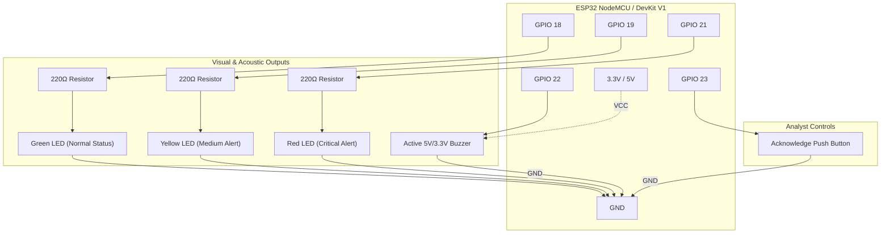

# ESP32 Physical Alert System — Circuit Diagram & Hardware Guide

This document specifies the hardware wiring, component selection, and pin mapping for the **Multi Modal Security (MMS) Phase 9 ESP32 Physical Alert System**.

---

## 1. Pin Connection Table

| ESP32 Pin | Component | Description / Details | Required Resistor |
| :--- | :--- | :--- | :--- |
| **GPIO 18** | **Green LED** | Anode (+) of Green LED | 220Ω - 330Ω to GND |
| **GPIO 19** | **Yellow LED** | Anode (+) of Yellow LED | 220Ω - 330Ω to GND |
| **GPIO 21** | **Red LED** | Anode (+) of Red LED | 220Ω - 330Ω to GND |
| **GPIO 22** | **Active Buzzer** | Signal / I/O pin (+) | None (standard 3.3V/5V module) |
| **GPIO 23** | **Push Button** | Physical Acknowledge Button | Internal `INPUT_PULLUP` enabled |
| **GND** | **Ground Rail** | Cathodes (-) of all LEDs, Buzzer GND, and Button terminal | Common Ground |
| **3.3V / 5V**| **Power Rail** | VCC of Active Buzzer Module | Direct to ESP32 3.3V or VIN (5V) |

---

## 2. Breadboard Wiring Schematic (ASCII Diagram)

```
        +-----------------------------------------------+
        |              ESP32 Dev Module                 |
        |                                               |
        |  [USB Micro/Type-C]                           |
        |                                               |
        |  GND -----------------------------------+     |
        |                                         |     |
        |  GPIO 18 ----[ 220Ω ]---->|-- (Green) --+     |
        |  GPIO 19 ----[ 220Ω ]---->|-- (Yellow) -+     |
        |  GPIO 21 ----[ 220Ω ]---->|-- (Red) ----+     |
        |                                         |     |
        |  GPIO 22 --------[ I/O ] Active Buzzer -+     |
        |   3.3V   --------[ VCC ]                |     |
        |                                         |     |
        |  GPIO 23 --------o/ o--- Push Button ---+     |
        |                                         |     |
        +-----------------------------------------|-----+
                                                  |
                                            (Common GND)
```

---

## 3. Visual Connection Diagram (Mermaid)



---

## 4. Hardware Operation & Alert Posture Matrix

| System State | Green LED | Yellow LED | Red LED | Active Buzzer |
| :--- | :--- | :--- | :--- | :--- |
| **Normal** | **ON (steady)** | OFF | OFF | Silent |
| **Low / Medium Alert** | OFF | **ON (steady)** | OFF | Silent |
| **High Alert** | OFF | OFF | **Blinking (slow 1s)** | Short beep every 5s |
| **Critical Alert** | OFF | OFF | **Blinking (fast 200ms)** | **Continuous tone** until acknowledged |

---

## 5. Physical Acknowledge Button Behavior
- When a high or critical alert triggers the continuous alarm and fast-blinking LED, the analyst can press the push-button wired to **GPIO 23**.
- **Hardware Feedback:** The buzzer immediately silences, red blinking stops, and the Green LED turns steady ON.
- **Platform Telemetry:** The ESP32 immediately publishes an acknowledge event back to the MMS platform on MQTT topic `alerts/ack`:
  ```json
  {
    "acknowledged": true,
    "device_id": "esp32-desk-01"
  }
  ```

